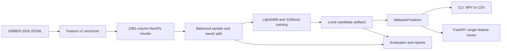

# MLWINT
### Machine Learning-Based Malware Intelligence and Detection System

MLWINT explores static malware detection with EMBER 2018 feature vectors,
LightGBM, XGBoost, and a 50/50 probability ensemble. It provides a NumPy
predictor, a command-line interface, and a FastAPI inference service.

**Status:** research prototype. Saved results are exploratory comparisons on
reused partitions, not a final independent benchmark. Trained models and
datasets are local artifacts and are intentionally absent from this GitHub copy.

## Motivation and objectives

Static feature classifiers can help prioritize suspicious Windows PE files
without executing them. This project compares tree-based classifiers, studies
threshold and regularization tradeoffs, and exposes a consistent feature-array
inference interface. Its objectives are reproducible comparisons, clear data
validation, and careful separation of model scores from verified malware labels.

## Capabilities

- Resumable vectorization of precomputed EMBER JSONL features, skipping unlabeled records.
- Balanced 100,000-row research sample and saved stratified 70/15/15 split indices.
- LightGBM and XGBoost inference, plus equal-weight probability averaging.
- Validation of feature dimensions, finite values, and decision thresholds.
- `.npy` batch inference with optional CSV output.
- API routes for health, supported model names, and one-vector prediction.
- Existing evaluation, threshold, latency, and regularization reports.

## Architecture



**Stack:** Python 3.13, NumPy, scikit-learn, LightGBM, XGBoost, FastAPI,
Pydantic, Uvicorn, pytest; optional EMBER/LIEF, pandas and Matplotlib for research.
The service accepts extracted features; a raw executable upload/scanning route is not implemented.

## Repository layout

```text
MLWINT/
├── README.md, LICENSE, CONTRIBUTING.md, SECURITY.md
├── pyproject.toml, requirements*.txt
├── MLWINT_CHAT_HANDOFF.md
├── configs/                 # documented settings and artifact manifest
├── data/                    # acquisition and regeneration guide
├── docs/                    # setup, architecture, experiments and limitations
├── src/
│   ├── analysis/            # EDA and provenance inspection scripts
│   ├── ingestion/           # JSONL inspection and vectorization
│   ├── detection/           # predictor.py, cli.py, api.py
│   └── models/              # training/evaluation scripts; candidates stored locally
├── tests/                   # synthetic unit/API/CLI tests and model integration tests
├── reports/ember/           # recorded metrics, plots and split indices
├── scripts/                 # project audits
├── deployment/              # local service guidance
└── .github/                 # CI and contribution templates
```

## Installation

Run commands from this repository root. The original working environment uses
**Python 3.13.3**; direct dependencies are pinned to versions observed there.
A fresh installation and Linux compatibility have not yet been verified.

Windows PowerShell:

```powershell
py -3.13 -m venv .venv
.\.venv\Scripts\python.exe -m pip install -r requirements-dev.txt
.\.venv\Scripts\python.exe -m pytest -m "not integration"
```

Linux/macOS (proposed equivalent):

```bash
python3.13 -m venv .venv
.venv/bin/python -m pip install -r requirements-dev.txt
.venv/bin/python -m pytest -m 'not integration'
```

The commands below use `python` from the project environment. On PowerShell,
activate with `. .\.venv\Scripts\Activate.ps1`, or replace `python` with the
explicit `.venv` executable. No environment variables or secrets are required.
Paths and hyperparameters are currently defined in Python scripts; see
[configuration](configs/README.md) and [installation details](docs/installation.md).

## Dataset and feature preparation

Obtain **EMBER 2018, feature version 2** from the
[official upstream repository](https://github.com/elastic/ember#download).
Extract its six training JSONL files and `test_features.jsonl` into
`data/raw/ember2018/`. MLWINT uses 2,381 features, float32 arrays, and labels
0 (benign) / 1 (malicious); unlabeled -1 rows are skipped.

Upstream licenses its extractor code under AGPLv3 and downloadable data under
MIT; MLWINT's MIT license does not replace upstream terms. See
[dataset provenance and checksum](docs/dataset.md) before redistribution.

Install optional extractor dependencies only after reviewing their terms and
compatibility notes in [installation](docs/installation.md):

```powershell
python -m pip install -r requirements-research.txt
python -m src.ingestion.vectorize_ember_chunks --chunk-size 500
python -m src.models.prepare_dataset
```

Vectorization resumes from its manifest. Preparation writes `X_sample.npy` and
`y_sample.npy`, overwriting existing sample arrays. Run regeneration in a
separate experiment copy if you already have working data. Preserve signed
hashed features, including negative values. See [feature engineering](docs/feature-engineering.md).

## Training and evaluation

These are existing entry points, provided for documentation; repository setup
does not run them. **Use a separate experiment copy:** the comparison script
rewrites split indices and candidate artifacts; other scripts overwrite their
own reports/artifacts. Keep the original models and split unchanged.

```powershell
python -m src.models.compare_models
python -m src.models.train_xgboost
python -m src.models.evaluate_ensemble
python -m src.models.reevaluate_regularization
```

`compare_models` creates the split and LightGBM/forest candidates;
`train_xgboost` reuses that split. The corrected regularization evaluator also
requires the saved regularized artifacts. See [training](docs/model-training.md)
and [evaluation](docs/evaluation.md) for inputs, outputs and caveats.

## CLI inference

Restore the appropriate trusted local artifacts to `src/models/candidates/`
before prediction. [Artifact manifest](configs/artifacts.json) records the
inspected model hashes; [artifact instructions](docs/artifacts.md) explain restoration.

```powershell
python -m src.detection.cli --model lightgbm --input data/processed/ember/model_data/X_sample.npy
python -m src.detection.cli --model ensemble --input data/processed/ember/model_data/X_sample.npy --threshold 0.5 --output reports/ember/model_comparison/cli_predictions.csv
```

Input is one 2,381-value vector or an `(n, 2381)` `.npy` array. Output contains
malicious-class probabilities and labels at the requested threshold. Scores
are model estimates, not independently verified file verdicts.

## FastAPI service

```powershell
python -m uvicorn src.detection.api:app --host 127.0.0.1 --port 8000
```

- `GET /health`: process health; does not load or verify model artifacts.
- `GET /models`: supported names; does not confirm their files are present.
- `POST /predict`: one feature vector, optional model and threshold.
- OpenAPI interface: `http://127.0.0.1:8000/docs`.

In another PowerShell window:

```powershell
Invoke-RestMethod http://127.0.0.1:8000/health
$body = @{ model = 'lightgbm'; features = @(0.0) * 2381; threshold = 0.5 } | ConvertTo-Json -Depth 3
Invoke-RestMethod http://127.0.0.1:8000/predict -Method Post -ContentType 'application/json' -Body $body
```

The zero vector is a transport smoke test, not a representative PE sample.
Missing models produce HTTP 503; invalid requests produce HTTP 422. See
[API reference](docs/inference-api.md) and [deployment notes](deployment/README.md).

## Recorded comparison

Validation: 15,000 rows from the balanced 100,000-row sample. F1 threshold: 0.5.
Values below are copied from the existing
[ensemble validation report](reports/ember/model_comparison/ensemble_validation_comparison.json),
not recomputed during repository preparation.

| Candidate | ROC-AUC | PR-AUC (average precision) | F1 |
|---|---:|---:|---:|
| LightGBM baseline | 0.995208 | 0.995536 | 0.967789 |
| XGBoost baseline | 0.995579 | 0.995812 | 0.967081 |
| 50/50 ensemble | 0.995611 | 0.995875 | 0.967759 |

Validation has been reused for early stopping, tuning and selection. Test
metrics have also been explored. Define a new independent evaluation protocol
before making final performance claims. Stronger regularization reduced the
recorded validation scores; see [experiment notes](docs/experiments.md).

## Tests and CI

```powershell
python -m pytest -m "not integration"
# With trusted local candidate models restored:
python -m pytest -m integration
```

CI targets Python 3.13 and runs synthetic inference, CLI and ASGI API tests
without datasets, model downloads or training. Existing artifact-backed tests
skip when models are absent. See [test guide](tests/README.md).

## Limitations and next steps

EMBER 2018 is historical static PE data. Generalization to current malware,
drift, calibration, adversarial robustness and operational thresholds remain
to be independently evaluated. Identical feature vectors do not establish
same-file or family leakage. Sample preparation currently omits source hash
mappings. A clean final evaluation set, provenance tracking, and deployment
authentication are future work. See [limitations](docs/limitations.md).

## Responsible use, license and citation

Use only for authorized defensive research. Do not execute unknown samples
on a normal workstation. This repository distributes source and lightweight
reports; no malware executables, raw dataset or trained artifacts are included.
See [SECURITY.md](SECURITY.md).

Existing project code is licensed under [MIT](LICENSE), copyright 2026 Kalmit
Kulkarni. Third-party dependencies and datasets retain their own licenses.
When using EMBER, cite Anderson and Roth, *EMBER: An Open Dataset for Training
Static PE Malware Machine Learning Models* (2018),
[arXiv:1804.04637](https://arxiv.org/abs/1804.04637), and identify the 2018/v2
dataset separately; the original paper describes EMBER 2017. No MLWINT DOI or
published paper has been verified.

See [GitHub publication guide](docs/github-publication.md) for the offline
GitHub Desktop workflow and the review checklist before a first commit/push.
