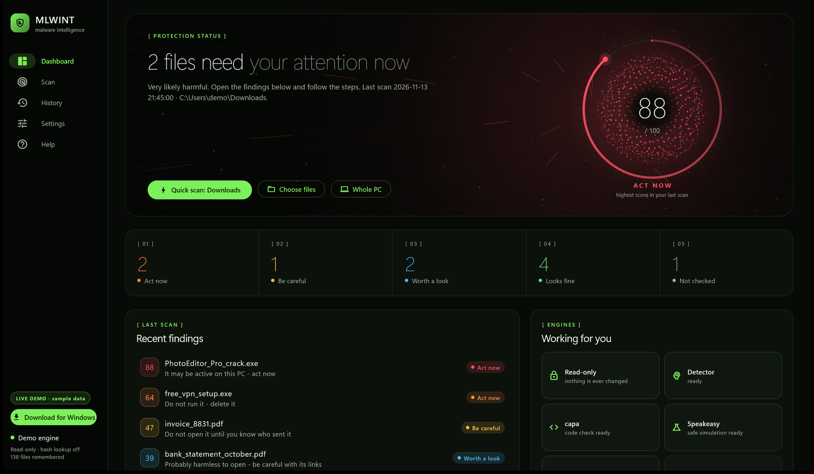
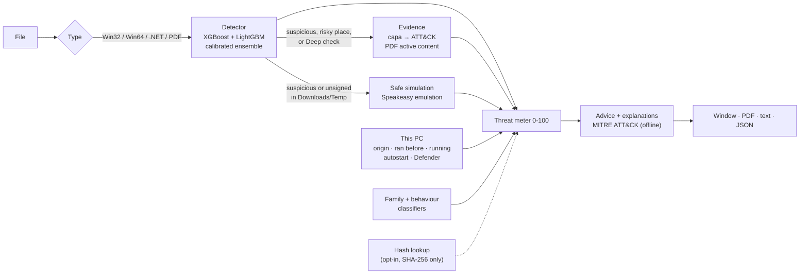
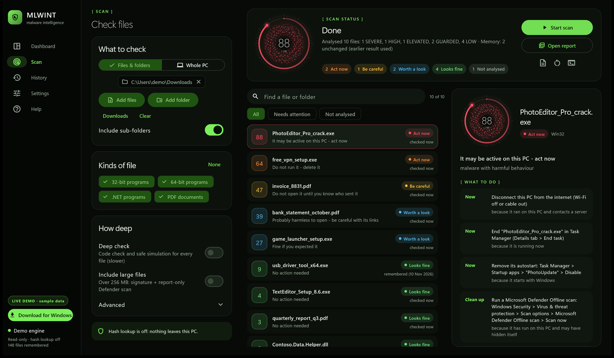
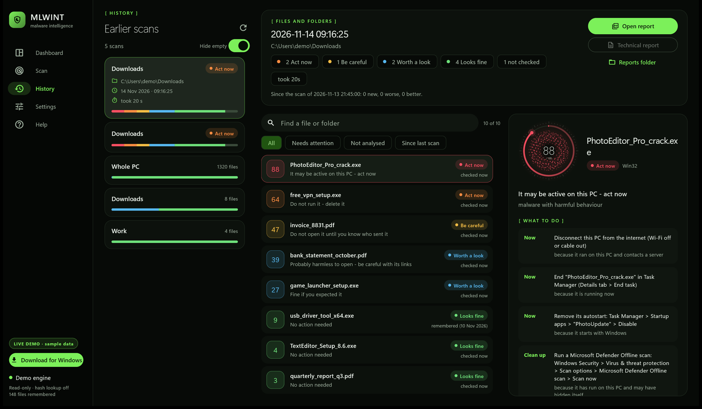
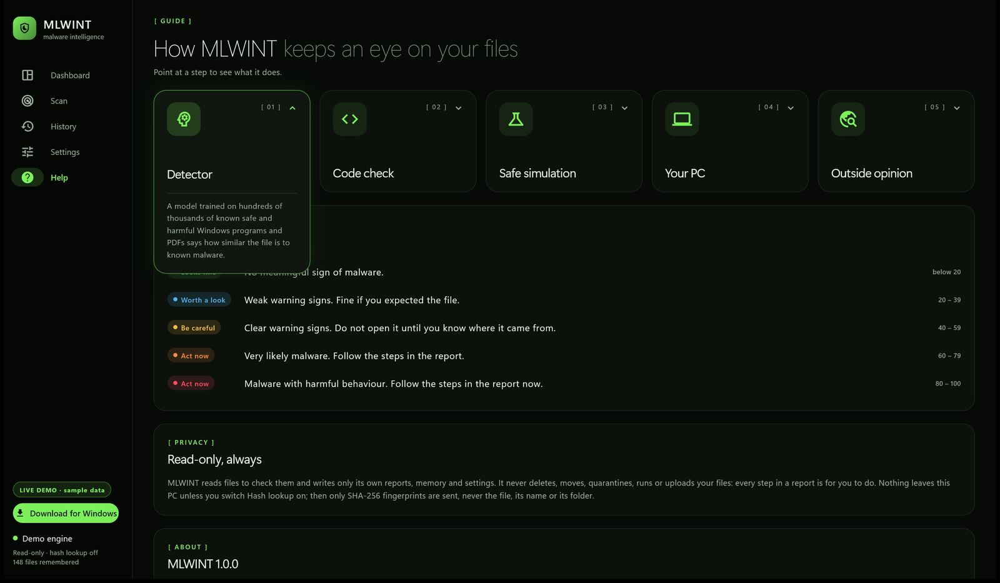
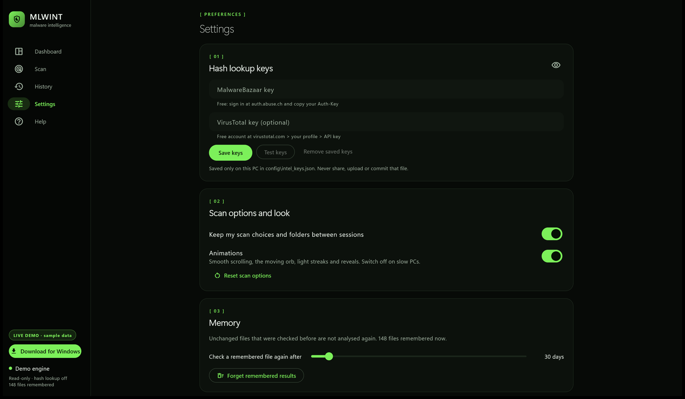
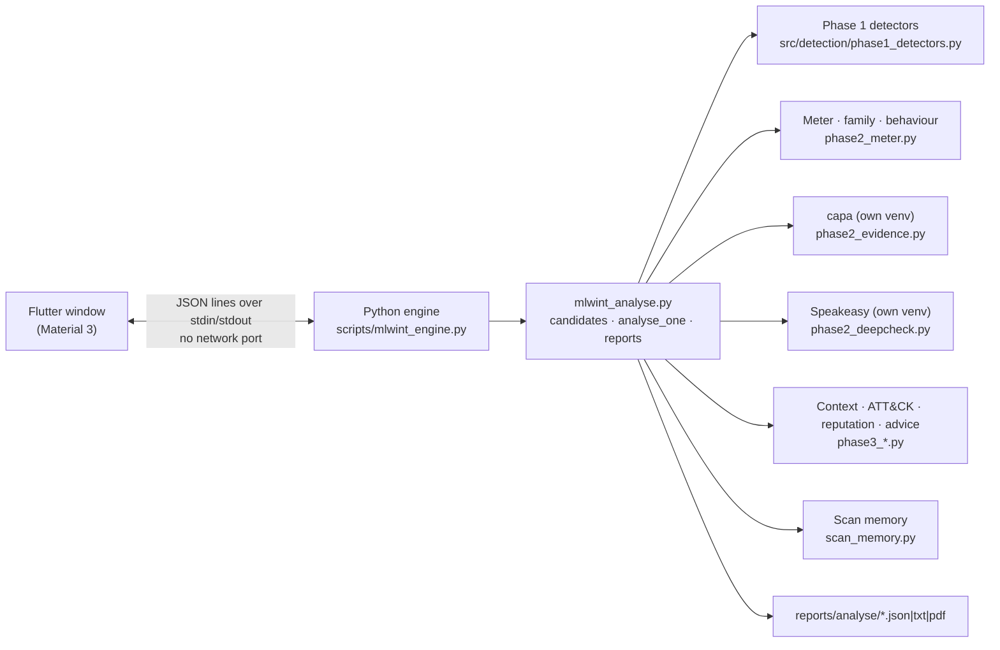

<p align="center">
  
</p>

<h1 align="center">MLWINT</h1>
<p align="center"><b>Machine-learning malware intelligence for Windows: a read-only "doctor" that explains what a file is,
what it can do, and what you should do about it.</b></p>

<p align="center">
  <a href="https://incsimple.github.io/MLWINT/"><b>▶ Try the live demo</b></a> ·
  <a href="https://github.com/IncSimple/MLWINT/releases/latest"><b>⬇ Download for Windows</b></a> ·
  <a href="docs/architecture.md">Architecture</a> ·
  <a href="docs/phase1-results.md">Results</a>
</p>

<p align="center">
  
  
  
  
  
</p>



Most antivirus tools give a verdict and act on it without explaining why. **MLWINT is the opposite: a careful
second opinion that shows its reasoning.** It scores every Windows program and PDF from 0 to 100, explains the
score in plain language (what the file is similar to, what it can do, what happened to it on this PC), and gives
step-by-step advice. **It never deletes, quarantines, runs or uploads anything.** Every decision stays with you.

---

## Contents
- [Live demo and download](#live-demo-and-download)
- [What it does](#what-it-does)
- [How a file is checked](#how-a-file-is-checked)
- [Screenshots](#screenshots)
- [Results](#results)
- [Privacy and safety](#privacy-and-safety)
- [Install](#install)
- [Architecture](#architecture)
- [Repository layout](#repository-layout)
- [Build from source](#build-from-source)
- [Releasing updates](#releasing-updates)
- [Limitations](#limitations)
- [Credits and licences](#credits-and-licences)

---

## Live demo and download

| | |
|---|---|
| **[Live demo](https://incsimple.github.io/MLWINT/)** | The real MLWINT window running in your browser with built-in **sample data**: browse the dashboard, run a simulated scan, open History and the detail panels, read the sample PDF report. Nothing on your computer is read or scanned. |
| **[Windows installer](https://github.com/IncSimple/MLWINT/releases/latest)** | `MLWINT-Setup-<version>.exe` (~260 MB): everything included (no Python or other installs needed). Installs for the current user only, no admin rights. |

---

## What it does

| | |
|---|---|
| 🔎 **Detect** | One specialist ML detector per file type (**Win32, Win64, .NET, PDF**), each an XGBoost + LightGBM ensemble trained on EMBER2024, with a calibrated three-tier verdict (clean / suspicious / malicious). |
| 🧬 **Analyse** | For flagged files: **malware family** and **behaviour** classifiers, **capa** capability analysis mapped to **MITRE ATT&CK**, a **safe simulation** (Speakeasy emulation, nothing really runs), and PDF active-content checks. |
| 🖥️ **Look at this PC** | Where the file came from (Mark of the Web), whether it was ever run, whether it is running now or starts automatically, and what Microsoft Defender already knows. Read-only. |
| 🧭 **Advise** | A transparent **0-100 threat score** with the reason for every point, and prioritised actions ("Now / Clean up / Protect / Check") that cite their evidence. |
| 🧠 **Remember** | A scan memory skips files that have not changed (same SHA-256, size, dates; same models), so repeat and whole-PC scans are fast. |
| 📄 **Report** | An easy-to-read PDF for non-technical users, plus a technical text report and full JSON. History compares every scan with the previous scan of the same place (new / worse / better). |
| 🌐 **Optional outside opinion** | Off by default. With your own MalwareBazaar / VirusTotal key, only the file's **SHA-256** is looked up, never the file, its name or its folder. |

**Threat levels**

| Score | Level | Shown as | Meaning |
|---|---|---|---|
| 0-19 | LOW | 🟢 Looks fine | No meaningful sign of malware |
| 20-39 | GUARDED | 🔵 Worth a look | Weak warning signs; fine if you expected the file |
| 40-59 | ELEVATED | 🟡 Be careful | Clear warning signs; do not open it until you know the source |
| 60-79 | HIGH | 🟠 Act now | Very likely malware; follow the steps |
| 80-100 | SEVERE | 🔴 Act now | Malware with harmful behaviour; follow the steps now |

---

## How a file is checked



The score is a sum of explained parts: detector (0-60), behaviour (0-25), evidence (0-15), family (+5),
context (-15 to +5), deep check (0-20), outside opinion; with floors for detector verdicts and a cap for PDFs
that contain nothing that can run. Every part is listed in the detail panel and the reports.

---

## Screenshots

| Scan | History |
|---|---|
|  |  |
| **Help (cards drop down on hover)** | **Settings** |
|  |  |

*All screenshots use the built-in sample data (`--dart-define=MLWINT_DEMO=true`); no real files are shown.*

The window is written in **Flutter** following **Material 3**: one seed colour (neon lime) through the M3 colour
system, tonal surfaces instead of shadows, the M3 shape scale, emphasized motion, fade-through page transitions,
a GPU-drawn 3-D particle "threat orb", eased (Lenis-style) wheel scrolling with a floating scroll pill instead of
scrollbars, and blur-to-clear reveals. An Animations switch turns all motion off for slow PCs.

---

## Results

### Detection (Phase 1), test weeks 52-63
Time-ordered evaluation on [EMBER2024](https://huggingface.co/datasets/joyce8/EMBER2024): train on weeks 0-35,
choose rounds on 36-39, calibrate and choose roles on 40-51, and score the **test weeks 52-63 only after every
choice was frozen**. Leakage audits (shared hashes, identical vectors, date order, single-feature AUC) run
before training.

Ensemble at the threshold set for 1% false alarms on development data:

| File type | Test files | Malware caught | False alarms | Test status |
|---|---|---|---|---|
| Win64 | 119,990 | **97.71%** | 1.08% | fresh (never seen before) |
| Win32 | 359,991 | **96.48%** | 0.99% | benchmark (seen once before) |
| PDF | 12,000 | **94.97%** | 2.67% | benchmark (models retrained on weeks 0-51) |
| .NET | 59,953 | **94.36%** | 0.89% | fresh |

**Shipped verdict policy** (thresholds from calibration data only): MALICIOUS where ≤ 0.5% of clean files
score, SUSPICIOUS down to ≤ 3%, else CLEAN.

| File type | Malware: malicious / suspicious / missed | Clean files wrongly malicious | Clean files suspicious |
|---|---|---|---|
| Win64 | 96.0% / 3.1% / **0.9%** | **0.47%** | 2.9% |
| Win32 | 95.2% / 2.8% / **2.0%** | **0.55%** | 2.3% |
| .NET | 91.3% / 6.6% / **2.1%** | **0.48%** | 2.0% |
| PDF | 93.5% / 4.3% / **2.2%** | 1.67% | 4.9% |


Key findings:
- **Gradient-boosted trees won every format.** XGBoost and LightGBM are statistically tied; their 50/50
  ensemble is the most stable. A linear SVM blend was tested on every format and **rejected every time**.
- **Win32 / Win64 / .NET are stable over time**; **PDF malware drifts fast** (retraining on weeks 0-51 cut missed
  malicious PDFs by about a quarter).
- On real downloads, ordinary PDFs (bank statements, certificates) look "phishing-like" to the PDF detector. MLWINT
  therefore **caps PDFs that contain nothing that can run at 39 (Worth a look)** and says "do not trust its links"
  rather than "malware".

### Analysis (Phase 2)
Family and behaviour classifiers (XGBoost, EMBER2024 tags), evaluated once on the test weeks after tuning on
development data. Family names are shown only at ≥ 90% precision; behaviour tags are weighted by their tested
precision (≥ 90% strong, 80-90% normal, 70-80% "possibly", below 70% hidden). Tested family precision: Win64
96.2%, .NET 89.9%, Win32 87.9%; PDF family names are hidden (drift).

Full tables, per-week curves and overfitting checks: [docs/phase1-results.md](docs/phase1-results.md) and
[`results/`](results/).

---

## Privacy and safety

- **Read-only.** MLWINT reads files to check them and writes only its own reports, memory and settings. It never
  deletes, moves, quarantines, runs or uploads your files; every step in a report is yours to do.
- **Offline by default.** Detection, analysis, MITRE ATT&CK explanations and reports all work without internet.
- **Hash lookup is opt-in** and uses your own keys; only SHA-256 fingerprints are sent.
- **Safe simulation** uses Speakeasy *emulation*: the program's instructions are interpreted inside a model of
  Windows; it is never really executed.
- **Large-file check** asks Microsoft Defender for a *report-only* scan (`-DisableRemediation`).
- **Your keys stay on your PC** in `config/intel_keys.json` (excluded from git and from the installer).

See [SECURITY.md](SECURITY.md) for responsible-use notes.

---

## Install

1. Download `MLWINT-Setup-<version>.exe` from [Releases](https://github.com/IncSimple/MLWINT/releases/latest).
2. Run it. Windows SmartScreen may say *"Windows protected your PC"* because the installer is not code-signed:
   click **More info → Run anyway**.
3. Start **MLWINT** from the Start menu. Try **Quick scan: Downloads** on the dashboard.

| Requirement | |
|---|---|
| OS | Windows 10 or 11, 64-bit |
| Disk | ~1.1 GB |
| Memory | 8 GB recommended (large installers need ~2 GB during analysis) |
| Admin rights | not needed (installs to `%LOCALAPPDATA%\Programs\MLWINT`) |

Updating: run a newer setup over the old one. Reports, settings, keys and the scan memory are kept.

---

## Architecture



- The **window** (`mlwint_app/`, Flutter) and the **engine** (`scripts/mlwint_engine.py`) talk through a private
  pipe, one JSON object per line. The same analysis code powers the command line (`scripts/mlwint_analyse.py`).
- **Three Python environments** keep conflicting dependencies apart: the main engine (EMBER2024 / ML stack), capa
  and Speakeasy. The installer ships one Python 3.13 runtime shared by all three.
- On the web, the same Flutter code runs with a **demo engine** (`lib/demo_engine.dart`) and sample data.

More detail: [docs/architecture.md](docs/architecture.md).

---

## Repository layout

```text
MLWINT/
├── mlwint_app/            Flutter window (Windows app + web demo)
│   ├── lib/               pages, theme, orb, smooth scrolling, engine bridge, demo engine
│   ├── assets/demo/       sample data for the demo (generated by packaging/make_demo_data.py)
│   ├── windows/  web/     platform runners
├── scripts/
│   ├── mlwint_engine.py   engine for the window (JSON lines)
│   ├── mlwint_analyse.py  command-line analyser (same code)
│   ├── mlwint_gui.py      earlier PySide6 window (kept as a fallback)
│   └── *_check.py         self-checks for every step
├── src/
│   ├── detection/         phase 1 detectors, phase 2 meter/evidence/deep check, phase 3 context/ATT&CK/
│   │                      reputation/advice, scan memory, large files
│   ├── report/            easy-to-read PDF report
│   ├── gui/               PySide6 window + helpers the engine reuses (history index, health check)
│   └── app_settings.py
├── packaging/             release builder, Inno Setup script, icon, demo data generator
├── environments/          pinned packages for the three Python environments
├── pipeline/              Phase 1 dataset preparation (PC) and training/evaluation (Colab)
├── results/               Phase 1 reports, curves and detector cards
├── docs/                  methodology, results, architecture, building, roadmap
└── version.json           app + models versions
```

Not in git: datasets, trained models (see [Releases](https://github.com/IncSimple/MLWINT/releases)), the Python
environments, capa rules, ATT&CK data, reports and keys.

---

## Build from source

Short version (full guide: [docs/building.md](docs/building.md)):

```bash
# 1. three Python 3.13 environments
python -m venv experiments/ember2024/.venv && experiments/ember2024/.venv/Scripts/python -m pip install -r environments/ember2024.txt
python -m venv experiments/capa/.venv      && experiments/capa/.venv/Scripts/python -m pip install -r environments/capa.txt
python -m venv experiments/speakeasy/.venv && experiments/speakeasy/.venv/Scripts/python -m pip install -r environments/speakeasy.txt

# 2. models, capa rules, MITRE ATT&CK data (see docs/building.md for the exact sources)
#    models/phase1, models/phase2          <- MLWINT-models-<version>.zip from Releases
#    tools/capa-source-v9.4.0/rules, sigs  <- capa v9.4.0 source release
#    data/attack/enterprise-attack.json    <- mitre-attack/attack-stix-data

# 3. the window
cd mlwint_app && flutter build windows --release

# 4. a full installer (bundle + Inno Setup)
experiments/ember2024/.venv/Scripts/python.exe packaging/build_release.py
```

Command line, without the window:

```bash
experiments/ember2024/.venv/Scripts/python.exe scripts/mlwint_analyse.py "C:\Users\you\Downloads" --recursive
```

Web demo: `flutter build web --release --base-href /MLWINT/` (sample data from `packaging/make_demo_data.py`).

---

## Releasing updates

1. Change the code and/or retrain models; raise `"app"` (and `"models"`) in [`version.json`](version.json).
2. `experiments/ember2024/.venv/Scripts/python.exe packaging/build_release.py`
3. Publish `dist/MLWINT-Setup-<version>.exe` as a GitHub Release.

Installing over an old version replaces the program and models and keeps user data; the scan memory notices new
models by itself and re-checks files. Details: [packaging/README.md](packaging/README.md).

---

## Limitations

- **Static ML has blind spots:** packed or encrypted programs, brand-new families and borderline "grayware".
  A score is evidence, not proof; the advice says so.
- **One dataset.** Models are trained and tested on EMBER2024; real-world PDFs differ (handled with the PDF cap,
  and a retrain on real clean PDFs is planned).
- **Emulation is partial:** modern system binaries often stop early in Speakeasy; MLWINT reports the coverage
  honestly ("saw very little").
- **Windows only** (Win32, Win64, .NET, PDF). ELF and Android models were explored but are out of scope.
- The installer is **not code-signed** yet.

---

## Credits and licences

MLWINT is released under the **MIT License** ([LICENSE](LICENSE)). It builds on:

| Component | Use | Licence |
|---|---|---|
| [EMBER2024](https://github.com/FutureComputing4AI/EMBER2024) / `thrember` | dataset and feature extractor | see the EMBER2024 project |
| [XGBoost](https://github.com/dmlc/xgboost) · [LightGBM](https://github.com/microsoft/LightGBM) | detector models | Apache-2.0 · MIT |
| [capa](https://github.com/mandiant/capa) (Mandiant FLARE) | capability analysis | Apache-2.0 |
| [Speakeasy](https://github.com/mandiant/speakeasy) (Mandiant) | Windows emulation | MIT |
| [MITRE ATT&CK®](https://attack.mitre.org/) | technique names, explanations, mitigations | © The MITRE Corporation, [terms of use](https://attack.mitre.org/resources/legal-and-branding/terms-of-use/) |
| [Flutter](https://flutter.dev/) · [win32](https://pub.dev/packages/win32) | the window | BSD-3-Clause |
| [Qt for Python / PySide6](https://doc.qt.io/qtforpython/) | PDF reports | LGPL-3.0 (dynamically linked) |
| [Inno Setup](https://jrsoftware.org/isinfo.php) | installer | Inno Setup licence |

ATT&CK® is a registered trademark of The MITRE Corporation. MLWINT is an independent project and is not affiliated
with MITRE, Mandiant, Microsoft, abuse.ch or VirusTotal.

Built by **Kalmit Kulkarni**.
