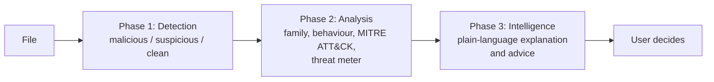
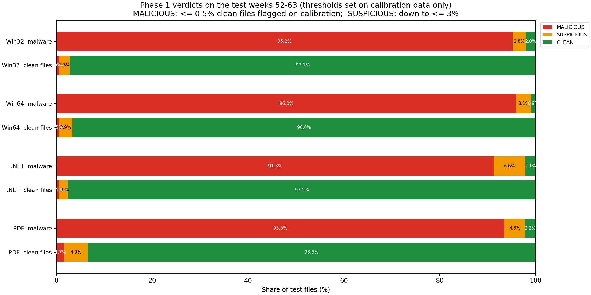

# MLWINT
### Machine Learning-Based Malware Intelligence for Windows

MLWINT is a **read-only malware "doctor" for Windows**. It examines a file, tells you in plain language
whether it is malicious, explains what the file appears to do, and advises you on what to do next.
It **never deletes, quarantines or modifies anything**. Every decision stays with the user.

> **Status:** Phase 1 (detection) is complete for all four Windows file types. Phase 2 (analysis) is
> being planned. This is a research project; the numbers below come from a public dataset, not from
> live deployment.

---

## Vision

Most antivirus tools give you a verdict and act on it without explaining why. MLWINT aims to be the
opposite: a careful second opinion that shows its reasoning.



| Phase | Question it answers | Status |
|---|---|---|
| **1. Detection** | Is this file malicious? How sure are we? | ✅ Complete |
| **2. Analysis** | What kind of malware is it, and what can it do? | 📝 Planning |
| **3. Intelligence** | What does this mean for me, and what should I do? | 🔜 Later |

**Scope:** Windows only. The four file types that matter most on a Windows PC are covered:

| File type | Why it matters |
|---|---|
| **Win32** programs (`.exe`/`.dll`, 32-bit) | The classic Windows malware carrier |
| **Win64** programs (64-bit) | Modern Windows software and malware |
| **.NET** programs | Large share of modern commodity malware |
| **PDF** documents | A common way malware is delivered by email |

---

## Phase 1: what has been achieved

### Approach
- **Data:** the [EMBER2024](https://huggingface.co/datasets/joyce8/EMBER2024) dataset (64 weekly snapshots,
  late 2023 to late 2024), using the same 2,568 static features (`thrember` feature extractor) for every
  file type. Files are analysed **without being executed**.
- **One specialist detector per file type.** For each type, four candidates were compared:
  XGBoost, LightGBM, XGBoost + linear SVM, and LightGBM + linear SVM. The best two (chosen on development
  data only) became **primary** and **challenger**, and their **50/50 ensemble** is the shipped detector.
- **Time-ordered evaluation**, the way a real product meets new malware:

  | Weeks | Use |
  |---|---|
  | 0–35 | training |
  | 36–39 | choosing the number of training rounds / SVM settings |
  | 40–51 | development: calibration, thresholds, choosing roles |
  | 52–63 | **test**: scored only after every choice was frozen |

- **Leakage controls:** no file (SHA-256) or identical feature vector is shared between periods; dates are
  strictly ordered; identical vectors with conflicting labels are removed; an independent audit checks all
  of this, plus "too good to be true" single features, before any training. Every run is checksummed and
  resumable.

### Detection results (test weeks 52–63)
Ensemble at a threshold set for 1% false alarms on development data:

| File type | Test files | Malware caught | False alarms | Test status |
|---|---|---|---|---|
| Win64 | 119,990 | **97.71%** | 1.08% | fresh (never seen before) |
| Win32 | 359,991 | **96.48%** | 0.99% | benchmark (seen once before) |
| PDF | 12,000 | **94.97%** | 2.67% | benchmark (models retrained on weeks 0–51) |
| .NET | 59,953 | **94.36%** | 0.89% | fresh |

Key findings:
- **Gradient-boosted trees won every format.** XGBoost and LightGBM are statistically tied; their ensemble
  is the most stable. Blending in a linear SVM was tested on every format and **rejected every time**:
  it fixes some files but breaks more.
- **Win32/Win64/.NET are stable over time** (development and test agree closely).
- **PDF malware drifts fast.** Retraining on all weeks 0–51 cut missed malicious PDFs by about a quarter;
  PDF thresholds still need extra care.

### Final verdict policy (Phase 1 close-out)
Each file gets one of three verdicts, with thresholds set on calibration data only:

| Verdict | Rule |
|---|---|
| 🔴 **MALICIOUS** | score above the level that flags ≤ 0.5% of clean files |
| 🟠 **SUSPICIOUS** | between that and ≤ 3% of clean files: *get a second opinion* |
| 🟢 **CLEAN** | below |

| File type | Malware: 🔴 / 🟠 / missed | Clean files wrongly 🔴 | Clean files 🟠 |
|---|---|---|---|
| Win64 | 96.0% / 3.1% / **0.9%** | **0.47%** | 2.9% |
| Win32 | 95.2% / 2.8% / **2.0%** | **0.55%** | 2.3% |
| .NET | 91.3% / 6.6% / **2.1%** | **0.48%** | 2.0% |
| PDF | 93.5% / 4.3% / **2.2%** | 1.67% | 4.9% |

Compared with a single 1% threshold, **missed malware roughly halved and false "malicious" verdicts roughly
halved** for every file type. Files marked *suspicious* are exactly the ones Phase 2 will investigate.



Full tables, per-week results and overfitting checks: [docs/phase1-results.md](docs/phase1-results.md).

---

## What is planned

**Phase 2: Analysis** (next)
- For every malicious or suspicious file: predict the **malware family**, **behaviour** and
  **MITRE ATT&CK techniques**, using the family, behaviour, capability (capa) and ATT&CK tags in EMBER2024.
- A **threat meter** combining the detection score with what the file can do.
- A suspicious verdict triggers deeper checks, so uncertain files get resolved instead of guessed.

**Phase 3: Intelligence**
- Plain-language explanations and advice ("what this file does, how risky it is, what you can do").
- A desktop app (PySide6) with model details one click away and real progress reporting.
- Still read-only: MLWINT advises, the user decides.

**Known limits.** Static features cannot see everything: packed/encrypted files, brand-new families and
borderline "grayware" remain hard, and results come from one dataset. An outside reality check on recent
files from another source is planned.

---

## Repository layout

```text
MLWINT/
├── README.md
├── docs/
│   ├── phase1-results.md      full Phase 1 results
│   ├── methodology.md         data splits, leakage controls, model selection rules
│   └── roadmap.md             phases 2 and 3 in more detail
├── pipeline/
│   ├── pc/                    dataset preparation on a PC (EMBER2024 -> feature shards)
│   └── colab/                 training and evaluation on Google Colab
│       ├── win32/  win64/     format-specific runs
│       ├── generic/           the same pipeline for any format (.NET, PDF)
│       └── closeout/          the Phase 1 verdict policy
├── results/                   reports, graphs and detector cards per file type
└── models/README.md           where to download the trained models
```

The trained models are published as a **GitHub Release** (`v1.0-phase1`), not stored in the repository.
Datasets are not redistributed; the pipeline downloads EMBER2024 from Hugging Face at a pinned revision.

## Reproducing Phase 1
See [pipeline/README.md](pipeline/README.md) for the run order. In short: prepare and export one file type
on a PC, upload the export to Google Drive, then run the Colab steps (leakage audit, XGBoost, LightGBM, SVM,
four-way comparison) and finally the close-out.

## License
MIT. See [LICENSE](LICENSE). EMBER2024 data and the `thrember` extractor are subject to their own licenses.
