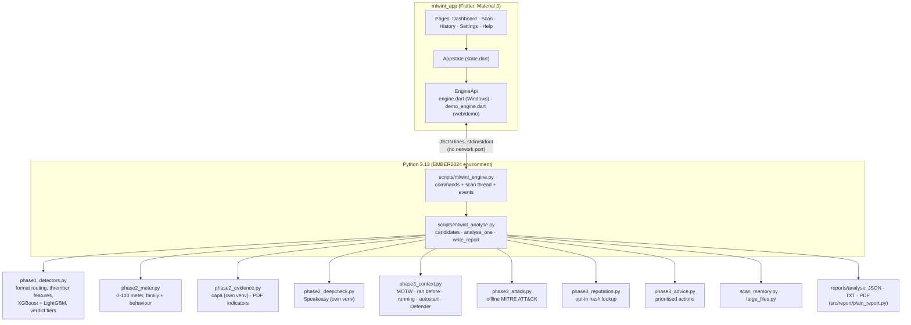

# Architecture

MLWINT has three layers: a **Flutter window**, a **Python engine** that drives the analysis, and the
**detection / analysis / intelligence modules** shared with the command line.



## The engine protocol
`scripts/mlwint_engine.py` is started by the window with the EMBER2024 environment's `pythonw.exe`. Each line on
stdin is a request, each line on stdout an answer or an event:

```text
app -> engine   {"id": 7, "cmd": "history"}
engine -> app   {"id": 7, "ok": true, "data": [...]}          or {"id": 7, "ok": false, "error": "..."}
engine -> app   {"event": "file", "i": 3, "n": 40, "result": {...}}      (while a scan runs)
```

Commands: `hello`, `health`, `status`, `history`, `report`, `scan`, `stop`, `text`, `open_report`,
`open_reports_folder`, `reveal`, `set`, `keep_options`, `reset_options`, `keys_save`, `keys_remove`, `keys_test`,
`forget`, `quit`. Events: `ready`, `log`, `phase`, `searching`, `counted`, `checking`, `file`, `finished`,
`failed`.

Design notes:
- The engine keeps **private copies of stdin and stdout**; everything else sees NUL as stdin and stderr as stdout.
  Windows ends a process when a child (PowerShell, capa, Speakeasy) touches the pipe a reader thread waits on.
- Scans run on a thread; the easy-to-read PDF (Qt) is made on the main thread.
- A scan thread that fails always sends `failed` before anything else, so the window never looks stuck.

## Three Python environments
| Environment | Holds | Why separate |
|---|---|---|
| `experiments/ember2024/.venv` | engine, thrember, XGBoost, LightGBM, scikit-learn, PySide6 (PDF) | the ML stack |
| `experiments/capa/.venv` | capa 9.4.0 + vivisect | capa's pinned dependencies |
| `experiments/speakeasy/.venv` | Speakeasy 1.5.11 + unicorn 1.0.2 | needs `setuptools<81` |

The installer ships **one** Python 3.13 runtime (`runtime/python`) and writes each environment's `pyvenv.cfg` to
point at it, so all paths in the code stay the same as in development.

## The threat meter
`phase2_meter.ThreatMeter` adds explained parts:

| Part | Points | Notes |
|---|---|---|
| detector | 0-60 | calibrated ensemble probability; floors: malicious ≥ 40, suspicious ≥ 20 |
| behaviour | 0-25 | only if the detector flags the file; weighted by tested tag precision |
| evidence | 0-15 | capa / PDF indicators mapped to ATT&CK; halved if the detector says clean |
| family | +5 | only at ≥ 90% tested precision |
| context | -15 .. +5 | signature, location |
| deep check | 0-20 | emulation findings; halved if clean |
| outside opinion | -10 .. +20 | opt-in hash lookup |
| PDF rule | cap 39 | a PDF with no JavaScript, launch action or embedded file |

Levels: LOW < 20 ≤ GUARDED < 40 ≤ ELEVATED < 60 ≤ HIGH < 80 ≤ SEVERE.

## Scan memory
`scan_memory.py` reuses a result only if the file's SHA-256 **and** its path, size, creation and modification
times match, the engine fingerprint (model manifests + detection code) is unchanged, the result is younger than
the memory window (30 days by default) and was checked at least as deeply. PC facts and outside opinion are
refreshed every scan.

## The window
- `state.dart`: one `AppState` (ChangeNotifier) shared through an `InheritedNotifier`; scan events are batched
  to at most ~8 repaints a second.
- `orb.dart`: the threat orb (Fibonacci-sphere particles drawn with `drawRawPoints`, depth layers, wobble by
  level, scanning band) and the hero light streaks; both repaint through a `ValueNotifier`, never rebuild widgets.
- `smooth.dart`: `SmoothScrollController` (custom `ScrollPosition.pointerScroll` with an exponential glide),
  the floating scroll pill, back-to-top button and scroll-triggered `Reveal`.
- `results.dart`: virtualised results list + detail panel.
- `platform/`: conditional imports (Windows: engine process, native file dialogs via `package:win32`;
  web: demo engine, `window.open`).
